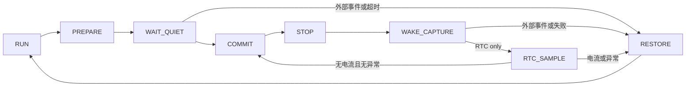

# 低功耗框架实施与验证

## 第一轮：进入条件的基础正确性

- RTC 使用高、低、高读取，避免 16 位进位造成计数拼接错误；STOP 返回后有界等待 RSF 同步。
- TIM3 提供单调的运行态毫秒计数。STOP 期间暂停，不当作实际日历时间；实际休眠时间使用 RTC 差值。
- USART1/2 半帧超过 100 ms 未收到后续字节时丢弃，仅处理 `IDLE + ptr_no != 0`，不截断已完整接收或发送中的帧。无符号差值兼容 tick 回绕。
- 恢复原有 RTC/SOC 表/铜损参数地址的写标志消费者，消除永久 pending。没有改变地址、协议或默认数据。

验证：`test_sleep.py`、`test_uart_stop.py`、`test_rtc_gpio.py` 通过。Keil Target 1 / ARMCC 5.06u7 编译链接成功，0 errors、10 warnings（现有业务代码警告），Code=43604、RO=2972、RW=1316、ZI=5872。临时关闭 BIN 后处理，构建结束恢复。尚未作为完整框架进行板上验证。

工程当前 `Optim=0`，旧 `check_armcc_no_bin.py` 固定要求 `Optim=3`，所以该旧检查不能代表当前工程；本轮以 UV4 实际构建为准。

## 第二轮：运行态 RTC 框架

`low_power.c` 只管理顺序和诊断，`low_power_port.h` 是编译期移植边界；`board_low_power.c` 适配本板 EXTI、电源和 STM32F1 RTC/STOP；`rtc_sleep.c` 保留原有请求 API 和 BMS 策略。既有 `conf.c` 的 GPIO/时钟恢复函数继续使用标准外设库。

主循环在最前面调用 `LowPower_Poll()`。返回 `LP_OWNS_CPU` 时只喂 watchdog，跳过所有普通任务；UART/ADC/通信电源关闭之后不允许普通业务再次访问。准备阶段 TIM3 和全局中断继续运行；PB12 必须连续低电平且无上升沿 5 ms 才提交，100 ms 不稳定则恢复 RUN。RTC 作为备用超时基准，运行态 tick 不走时也会退出。固定电源瞬态与此窗口内真正的短通信脉冲无法仅靠软件区分，若产品要求这一窗口内也零丢失，必须增加硬件锁存或改变供电/检测电路。

PA0/按键在 PB12 隔离期间保持有效。PB12 完成稳定检查之后不再清 pending，最后检查和 WFI 交接保持原 PRIMASK；RTC 和外部源同时到达时，记录全部来源并恢复 RUN。无来源的 STOP 返回有界重试 8 次，然后记录失败、恢复 RUN。旧 HICCUP Flash 标志也转入正常初始化之后的框架。

`g_irq_t` 仅保留兼容的首次中断来源。新增诊断分别保存 blocker、wake、policy exit、fault，不能把 `wake_mask` 的累计值直接当作本周期未消费事件。

验证：生产核心的故障注入测试覆盖等待、超时、最终边沿、RTC/外部同时到达、周期采样、无来源重试上限、RTC 初始化/设置/同步失败、RTC 回绕和恢复原中断状态。既有低压/空闲策略、reset sleep 事务、GPIO、UART/HardFault 检查通过。Keil AXF 链接成功，Code=44800、RO=2972、RW=1340、ZI=6192；RAM STOP 函数仍在 `0x20000000`。板上验证在全部框架完成后进行。

## Keil 调试与移植

Watch 中添加 `g_low_power_diag`、`g_hardfault_record`、`RTC_ExtComCnt`、`rtc_cnt`。诊断存在 RAM，reset 后重新初始化，不承诺掉电保留。`trace` 是 8 条循环记录，按 `sequence` 排序；ISR 仅原子合并唤醒位，不写整条日志。

| 字段 | 用途 |
| --- | --- |
| `state` | 0 RUN、1 PREPARE、2 WAIT_QUIET、3 COMMIT、4 STOP、5 WAKE_CAPTURE、6 RTC_SAMPLE、7 RESTORE |
| `block_mask` | bit0 串口、1 存储、2 电流、3 加热、4 均衡、5 MOS、6 AFE、7 唤醒输入、8 通信计数改变、9 配置、10 软件保护 |
| `wake_mask` | bit0 RTC、1 PA0、2 按键、3 PB12、4 USART1、5 USART2、6 USART3、7 其他；会话内累计 |
| `first_wake` | 会话首个来源；同一批多源同时采到时以最低位作为确定的代表，不代表物理时间先后 |
| `exit_mask` | bit0 电流、1 AFE/均衡、2 MOS、3 UV、4 OV、5 配置、6 请求变化 |
| `fault_mask` | bit0 RTC init、1 RTC arm、2 RSF、3 准备超时、4 时钟、5 reset sleep 事务、6 无来源返回过多、7 运行态 tick 停止、8 存储写失败、9 存储范围非法 |
| `comm_pending_mask` | USART1 的 bit0 TX/TC、1 半帧、2 完整帧/协议状态、3 硬件 RX/错误；USART2 对应 bit4..7 |
| `storage_pending_mask` | bit0 升级、1 升级参数、2 事件清除、3 电压电流保护、4 温度保护、5 其他保护、6 其他参数、7 加热参数、8 RTC、9 SOC 表、10 铜损、11 校准、12 AFE 参数待应用 |
| `storage_write_failures/last_address/last_value` | 失败次数、最后失败的 EEPROM 地址和值；写失败保留 pending，不伪装成功 |
| `stop_count/rtc_wake_count` | STOP 尝试次数、识别到的周期 RTC 唤醒次数；不等于功耗测量 |
| `quarantine_edges` | 受控电源切换稳定窗口内 PB12 边沿数 |
| `gpio*/exti*/nvic_pending/rtc_crl/primask` | 最近转换时的寄存器快照；不是连续采样波形 |

在 `LowPower_DebugHook()` 设置条件断点：`state == 2` 看稳定等待；`state == 7` 看为什么恢复；`state == 5` 看 STOP 返回现场。在 `HardFault_Record()` 断点查看堆栈 PC/LR、CFSR/HFSR/BFAR/MMFAR，不能把 HardFault 循环自身的 PC 当成异常指令。

`LOW_POWER_DEBUG_PROFILE` 可在 Keil C/C++ Define 中设置：0 为真实低功耗；1 保留 STOP 调试和暂停时 IWDG 冻结，适合单步但不能据此验收电流；2 跳过 WFI，采样一次后恢复，仅用于顺序/状态调试。默认 0。`iwdg_compiled` 显示当前工程是否编译开启 watchdog，本任务保留用户对 `conf.h` 的设置。发布时需在开启 IWDG、脱离调试器的条件下复测，RTC 间隔必须小于 watchdog 最短超时（考虑 LSI 漂移）。

移植按以下顺序操作：

1. 保留 `low_power.c/h`；新板实现 `low_power_port.h` 的板级函数，新的 BMS/AFE 实现策略函数。这里没有运行时注册和回调表。
2. 更新 `conf_gpio.h`、`conf.c` 的运行/RTC GPIO 掩码、电源输出保持值以及板级 EXTI 的 port/line/边沿/极性。一个 EXTI line 同时只能选一个 GPIO port，NVIC 的共享 IRQ 要逐一检查 PR。
3. 为每个低功耗模式列清楚哪些器件仍供电、哪些 IO 输入有确定电平、哪些输出必须保持。断电器件的 UART RX 不得直接当作合法唤醒源。新唤醒源增加独立位、ISR 通知及最终电平/pending 检查。
4. 更新策略的电流单位、采样有效性、保护/均衡/加热/参数写条件。当前进入阈值沿用 `u16Ichg/u16IDischg > 10`（每 LSB 100 mA），周期退出沿用非零电流（还受现有零点/死区限制）；未更改保护阈值。
5. 查清 STOP 后时钟源、RTC RSF、外设恢复顺序、watchdog 和时间补偿。`System_GetUptimeMs()` 只统计 TIM3 运行时间，不能用于包含 STOP 时间的墙钟计算。
6. 先运行核心/端口测试，再 AXF 编译，确认 MAP 中 STOP 例程仍在 RAM；再验收静默通信盒、真实通信、按键、PA0、充放电、低压、保护、EEPROM 失败、单步和长期电流。

当前周期采样来自 AFE，保持硬件保护工作；MCU ADC/MOS 温度仅在回到 RUN 后恢复采样。若新产品要求休眠期间持续监控 MCU 直连温度或新增检测器，应扩展板级采样状态和新鲜数据判断，不能把停机前缓存当成新的测量值。

## 中断与异常唤醒的原理

GPIO 电平、外设标志、外设中断使能、EXTI pending、EXTI mask 和 NVIC pending/enable 是不同层。进入 IRQ 并不证明收到合法协议帧；插入通信盒、电源变化、RX 低电平/噪声都可能产生 RXNE、FE、NE 或 ORE。USART1 的中断路由与 PB7 的 EXTI7 也是两条路径；STM32F1 STOP 时 USART 时钟停止，起始位检测依靠有效供电的 GPIO/EXTI，而不是照搬其他 STM32 系列的 USART STOP 唤醒功能。

本板关闭通信电源时，PA3/PB7 的数字输入可能被无电器件拖动。运行态应先等发送 TC、检查半帧/完整帧和参数写，再关闭 USART 外设中断与 NVIC、按 SR→DR 顺序清错误并关闭 USART，然后切电源和 GPIO 模式。RTC 只保留 PA0/PA9/PB12，PB12 采用高有效上升沿，PA9 低有效下降沿。PB12 电源切换瞬态通过有限稳定窗口处理，窗口后 pending 必须保留。

清 pending 只在明确的初始化/受控隔离阶段进行。进入 STOP 最后阶段如果先检查再清标志，会擦掉刚来的真实事件；如果先开中断再恢复系统时钟，则 ISR 可能以错误时钟访问外设。这里保持 PRIMASK 到时钟恢复、RTC 同步和唤醒捕获完成，再恢复调用者原 mask。RTC 与外部源同时来时全部记录，外部源优先恢复 RUN。

单步会把原本几个指令的停机/恢复窗口拉长，还会改变 RTC、watchdog、UART 溢出和 debug 时钟的相对时序。因此“全速不 HardFault”不能证明该路径适合单步。此前该板已有 Flash 中 STOP 返回异常而 RAM 中例程正常的实测记录，本次保留 RAM scatter 放置；这是有效规避证据，不能单凭它认定 MCU 硅缺陷。新问题须依据 `g_hardfault_record` 的原始堆栈和 fault 寄存器定位。

RTC STOP 后的 RSF 同步与 HSI 恢复行为参见 ST [RM0008](https://www.st.com/resource/en/reference_manual/cd00171190-stm32f101-103-105-107-stm32f100-series-armbased-32bit-mcus-stmicroelectronics.pdf) 的低功耗和 RTC 章节。具体芯片 errata 必须对应实物 ID/revision，不能由工程名称推断。

## 第三轮：待处理状态与诊断补齐

UART 半帧超时在新字节到达前也执行，避免超过窗口的新帧拼接到旧半帧；完整帧和 TX 状态不受影响。EEPROM 各类别一次写一个字段，失败保留 pending 并在运行态 100 ms 后重试；非法位/索引保留证据并阻止睡眠。初次初始化写入预算 512 次，失败不写完成标志；AFE 初始化重试有界。没有新增 Flash 布局或持久化格式。

`AFE_ResetFlag` 是不清除的历史标志，因此不作为 pending；`AFE_PARAM_WRITE_Flag` 才是待应用参数。普通 RTC 还检查软件保护位，SOC-full 标志除外。RTC 采样中的常规电流串口日志被抑制。

旧 SOC/铜损表的写入地址得到保留，但本任务没有增加开机读表/迁移或断电原子事务；不能把写标志能排空等同于新增了可靠存储系统。

第三轮验证：核心、策略、RTC LSI/LSE、GPIO、UART、PB12/半帧/写失败注入、当前标定（10000 随机及 65536 CADC）、启动/AFE 两种化学体系测试通过；Keil Code=45132、RO=2972、RW=1356、ZI=6224，0 errors、7 处现有警告。未生成 BIN。
