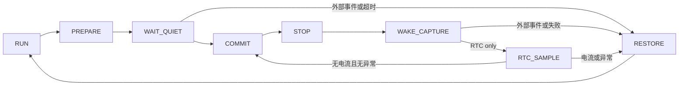

# 低功耗框架实施与验证

## 第一轮：进入条件的基础正确性

- RTC 使用高、低、高读取，避免 16 位进位造成计数拼接错误；STOP 返回后有界等待 RSF 同步。
- TIM3 提供单调的运行态毫秒计数。STOP 期间暂停，不当作实际日历时间；实际休眠时间使用 RTC 差值。
- USART1/2 半帧超过 100 ms 未收到后续字节时丢弃，仅处理 `IDLE + ptr_no != 0`，不截断已完整接收或发送中的帧。无符号差值兼容 tick 回绕。
- 恢复原有 RTC/SOC 表/铜损参数地址的写标志消费者，消除永久 pending。没有改变地址、协议或默认数据。

验证：`test_sleep.py`、`test_uart_stop.py`、`test_rtc_gpio.py` 通过。Keil Target 1 / ARMCC 5.06u7 编译链接成功，0 errors、10 warnings（现有业务代码警告），Code=43604、RO=2972、RW=1316、ZI=5872。临时关闭 BIN 后处理，构建结束恢复。尚未作为完整框架进行板上验证。

工程当前 `Optim=0`，旧 `check_armcc_no_bin.py` 固定要求 `Optim=3`，所以该旧检查不能代表当前工程；本轮以 UV4 实际构建为准。

## 第二轮：运行态 RTC 框架

`low_power.c` 只管理顺序和诊断，`low_power_port.h` 是编译期移植边界；`board_low_power.c` 适配本板 EXTI、电源和 STM32F1 RTC/STOP；`rtc_sleep.c` 保留原有请求 API 和 BMS 策略。既有 `conf.c` 的 GPIO/时钟恢复函数继续使用标准外设库。

主循环在最前面调用 `LowPower_Poll()`。返回 `LP_OWNS_CPU` 时只喂 watchdog，跳过所有普通任务；UART/ADC/通信电源关闭之后不允许普通业务再次访问。准备阶段 TIM3 和全局中断继续运行；PB12 必须连续低电平且无上升沿 5 ms 才提交，100 ms 不稳定则恢复 RUN。RTC 作为备用超时基准，运行态 tick 不走时也会退出。固定电源瞬态与此窗口内真正的短通信脉冲无法仅靠软件区分，若产品要求这一窗口内也零丢失，必须增加硬件锁存或改变供电/检测电路。

PA0/按键在 PB12 隔离期间保持有效。PB12 完成稳定检查之后不再清 pending，最后检查和 WFI 交接保持原 PRIMASK；RTC 和外部源同时到达时，记录全部来源并恢复 RUN。无来源的 STOP 返回有界重试 8 次，然后记录失败、恢复 RUN。旧 HICCUP Flash 标志也转入正常初始化之后的框架。

`g_irq_t` 仅保留兼容的首次中断来源。新增诊断分别保存 blocker、wake、policy exit、fault，不能把 `wake_mask` 的累计值直接当作本周期未消费事件。

验证：生产核心的故障注入测试覆盖等待、超时、最终边沿、RTC/外部同时到达、周期采样、无来源重试上限、RTC 初始化/设置/同步失败、RTC 回绕和恢复原中断状态。既有低压/空闲策略、reset sleep 事务、GPIO、UART/HardFault 检查通过。Keil AXF 链接成功，Code=44800、RO=2972、RW=1340、ZI=6192；RAM STOP 函数仍在 `0x20000000`。板上验证在全部框架完成后进行。
